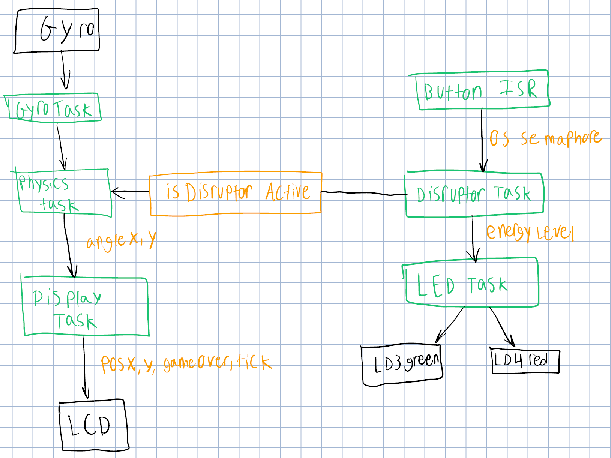

# Labyrinth on STM32

Labyrinth is a tilt-controlled maze prototype for the **STM32F429I-DISC1**. The board’s gyroscope supplies input, FreeRTOS tasks update the simulation, and the LCD renders the maze.

## Engineering work

- **Sensor and physics:** Read the gyroscope, convert raw values to degrees per second, and integrate tilt to update motion.
- **Scheduling:** Move the call to `osDelayUntil()` inside the physics loop so updates wait for the next scheduled tick.
- **Maze and display:** Generate walls and holes, render the layout and game state, and implement wall collision and hole detection.

The archived hardware checks recorded tilt in both axes, wall collision, and loss on entering a hole. [Validation notes](docs/validation.md) describe the tested scope, and the [task diagram](docs/task-diagram.png) records the original design.

## Build and run

1. Connect an STM32F429I-DISC1 over its ST-LINK USB port.
2. In STM32CubeIDE, import the [firmware folder](firmware/) as an existing project. It contains the Eclipse project files, CubeMX configuration, and flash linker script.
3. Build the **Debug** configuration and start a debug session to flash it. Resume execution, then tilt the board to move through the maze.

Application tasks and game logic are in [Core/Src](firmware/Core/Src/). The STM32 drivers and FreeRTOS/CMSIS support are under [Drivers](firmware/Drivers/) and [Middlewares](firmware/Middlewares/), with their original notices.
